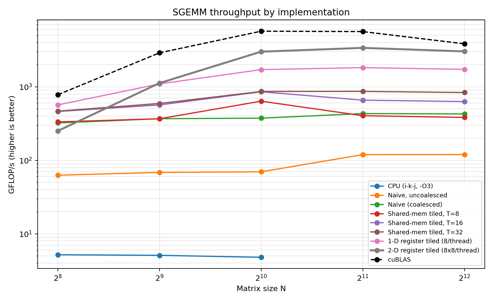

# gpu-gemm

Single-precision matrix multiply (SGEMM) on an NVIDIA GPU, built up in stages from a
one-thread-per-output kernel to a 2-D register-tiled kernel, and measured against cuBLAS
at every step.

The point isn't to beat cuBLAS. It's that each kernel here removes one specific hardware
bottleneck, the predicted effect was written down before the run, and the measurement
either confirmed it or didn't. Where it didn't, that's in the README too.

**Result:** the 2-D register-tiled kernel reaches **79% of cuBLAS** at N=4096 and **7.1×** a
coalesced naive kernel, at 50% occupancy with zero register spills.

Hardware: Tesla T4 (Turing, 40 SMs, `sm_75`) on Google Colab. CUDA 12.x.



## Results at N = 4096

| Kernel | GFLOP/s | ms | vs. naive | % of cuBLAS | Arithmetic intensity |
|---|---:|---:|---:|---:|---:|
| `cpu` (i-k-j, `-O3`) | 4.8 *(at N=1024)* | — | — | — | — |
| `naive_uncoal` | 120 | 1147.2 | 0.28× | 3.1% | 0.25 (scattered) |
| `naive` | 427 | 321.9 | 1.00× | 11.1% | 0.25 |
| `tiled8` | 383 | 359.0 | 0.90× | 10.0% | 2 |
| `tiled16` | 630 | 218.3 | 1.47× | 16.4% | 4 |
| `tiled32` | 836 | 164.5 | 1.96× | 21.8% | 8 |
| `reg1d` | 1725 | 79.7 | 4.04× | 44.9% | 16 |
| **`reg2d`** | **3028** | **45.4** | **7.09×** | **78.9%** | **32** |
| `cublas` | 3840 | 35.8 | 8.99× | 100% | — |

All numbers are from a single run on one T4, median of 7 after a warm-up. Session-to-session
variance across runs is around 3%, so treat the last digit as noise.

Arithmetic intensity is FLOPs performed per byte read from DRAM. The T4 does about
8.1 TFLOP/s of FP32 against 320 GB/s of bandwidth, so its balance point is roughly
**25 FLOP/byte**. Anything below that line is waiting on memory, and raising intensity
is the only lever that matters. That's the whole design of the progression below.

## The progression

**1. CPU baseline.** Correctness oracle and starting point. Uses `i-k-j` loop order so the
inner loop walks `B` and `C` contiguously; the textbook `i-j-k` version strides down a
column of `B` and is several times slower for identical arithmetic. Compiled `-O3`. A slow
baseline would have made every speedup number below meaningless, so it's worth getting right.

**2. Naive kernel.** One thread per output element, accumulating in a register.
`threadIdx.x` maps to the column index, so within a warp the reads of `B` and the writes to
`C` are consecutive addresses and coalesce into full memory transactions. Intensity is
0.25 FLOP/byte — two 4-byte loads to feed one multiply and one add.

Naive roofline says `0.25 × 320 GB/s ≈ 80 GFLOP/s`. It measured 427. The gap is the L2
cache absorbing reuse that the intensity figure doesn't model, which is a useful reminder
that the roofline bounds DRAM traffic, not total traffic.

**3. The coalescing experiment.** `naive_uncoal` is arithmetically identical to `naive`.
The only change is one line: `threadIdx.x` maps to the row instead of the column. Now a
warp's 32 addresses are `N` floats apart, so a single request scatters into 32 separate
32-byte transactions, each delivering 4 useful bytes.

Cost: **3.6×**, from nothing but the thread-to-data mapping. I kept this kernel in the repo
deliberately. It's the only controlled experiment here where a single variable changes and
everything else is held fixed, and it's the clearest evidence that coalescing is a real
effect and not folklore.

**4. Shared-memory tiling.** Each block stages a `TILE × TILE` sub-block of `A` and `B`
into shared memory and reuses every staged value `TILE` times, dropping DRAM traffic from
O(N³) to O(N³/TILE). Intensity becomes `TILE/4`.

Two barriers are required, and the second one is the one people drop. The first is
write-then-read: nobody may read the tile before every thread has finished writing it. The
second is read-then-write: nobody may start overwriting the tile for the next iteration
while slower threads are still reading the current one. Omitting it gives an intermittent
race that returns wrong numbers and never crashes.

**5. Tile-size sweep** (`tiled8`, `tiled16`, `tiled32`). Bigger tiles raise intensity but
cost resident blocks, so the optimum is empirical. Two results worth having:

**`tiled8` is slower than no tiling at all** — 383 vs. 427 GFLOP/s at N=4096, a 0.90×
"speedup". Its intensity is 8× the naive kernel's, and it still loses. An 8×8 tile means
only 8 iterations of useful work between two barriers, so barrier and index overhead eats
the gain, and the naive kernel meanwhile gets a large uncounted assist from L2.

**`tiled16` degrades with N while `tiled32` holds flat** — 855 → 658 → 630 GFLOP/s across
N = 1024, 2048, 4096, against 863 → 866 → 836 for `tiled32`. At N=1024 the two are within
1% of each other; by N=2048 `tiled32` is 32% ahead. As the working set grows, L2 captures a
smaller share of the reuse, and the lower-intensity kernel is the one that suffers for it.

**6. 1-D register tiling.** Tiling alone plateaus because the inner loop issues two
shared-memory loads per FMA, and shared memory can't feed the ALUs at that ratio. So each
thread takes on 8 output elements (a column strip) held in registers: one `B` value loaded
from shared memory now feeds 8 multiply-adds. Intensity doubles to 16, and the 512-thread
block also lets two blocks sit on an SM, so a barrier stall in one has somewhere to go.

**7. 2-D register tiling.** `reg1d` still gets no register reuse on the `A` side — its 8
`A` values are each used exactly once. Giving each thread an 8×8 block and taking an outer
product per k-step fixes that: 16 shared-memory loads now feed 64 FMAs, against 9 loads for
8 FMAs before. Intensity doubles again to 32 FLOP/byte, which finally clears the T4's
balance point of 25 — the first kernel here that isn't DRAM-bound.

Two details make it actually fast rather than just theoretically better. `A` is staged
*transposed* in shared memory, so the compute loop reads a column of `A` contiguously.
That in turn makes the shared-memory reads vectorizable as `float4`, which cuts the
load instruction count 4× and sidesteps a bank conflict: with scalar loads, the 16 threads
of a half-warp read `B` at 8-float strides and collide 4 ways on the same banks.

Measured: **3,028 GFLOP/s, 78.9% of cuBLAS**, 1.76× over `reg1d`. The prediction going in
was 1.5–2×. `ptxas` confirms the resource model too — **119 registers, 0 bytes spilled**,
8 KB shared, which puts two blocks on an SM at 50% occupancy, exactly the trade the design
was making.

## Negative results

Worth recording, because the explanation is the interesting part:

- **Padding shared memory (`[TILE][TILE+1]`) did nothing for `k_tiled`.** The usual fix for
  bank conflicts doesn't apply here. With a 32×32 block, a warp is one row of threads, so
  `As[ty][k]` is the same address for all 32 lanes (a broadcast, free) and `Bs[k][tx]` is 32
  consecutive floats across 32 distinct banks. There was no conflict to remove.
- **cuBLAS drops from ~6100 GFLOP/s at N=2048 to ~3900 at N=4096.** My kernels don't. Most
  likely thermal or power throttling on the shared Colab T4 once the run has been hammering
  the card for a while, since cuBLAS is the last kernel benchmarked at each size. I haven't
  confirmed it with `nvidia-smi` sampling, so I'm flagging it rather than explaining it away.
- **Every kernel plateaus past N=1024.** Below that there simply isn't enough parallelism to
  fill 40 SMs, and launch overhead is a visible fraction of the runtime.

## Correctness

Performance numbers are worthless if the kernel is quietly wrong, and a misindexed CUDA
kernel returns garbage without crashing. Three gates:

- **Deterministic self-test before any benchmarking.** Fill `A = B = 1`; every element of
  `C` must then equal exactly `N`, with no floating-point tolerance at all. It runs at
  **N = 257**, which is prime to every tile size in the repo, so it also exercises the
  ragged-edge bounds guards in every kernel. The benchmark refuses to run if this fails.
- **Element-wise comparison against the CPU reference** at N ≤ 1024, max relative error
  under 1e-3 (typically ~2e-7). Above 1024 the O(N³) reference is too slow, and those rows
  are reported as unverified rather than quietly assumed correct.
- **`compute-sanitizer` clean**, run after every kernel change.

One subtlety on the error metric: it normalizes by `max|C|` over the whole matrix, not
per element. Per-element relative error is meaningless for GEMM with random inputs — outputs
are sums of random-signed products, so plenty of them land near zero by cancellation, and
ordinary float rounding then reports an enormous relative error on a number that's correct
to the last bit. I tried it per-element first and got `[FAIL]` on everything, cuBLAS included.

## Build and run

```bash
make ARCH=sm_75          # T4. sm_80 for A100, sm_89 for L4
mkdir -p results
./bin/gemm               # self-test, then benchmark, then writes results/results.csv
python bench/plot.py     # -> results/benchmark.png, results/summary.png
```

The benchmark takes a couple of minutes; most of it is `naive_uncoal` at N=4096,
which is slow on purpose. Two optional checks:

```bash
make regs                     # register counts per kernel; watch for spill bytes
compute-sanitizer ./bin/gemm  # race and out-of-bounds detector
```

On Colab:

```python
!git pull && make ARCH=sm_75 && mkdir -p results && ./bin/gemm
```

## Methodology

- Kernel time only, via `cudaEvent`. Launches are asynchronous, so a host-side timer
  measures how long it took to *enqueue* the work, not to run it.
- One untimed warm-up launch, then the median of 7 timed runs. Median rather than mean
  because GPU timing noise is one-sided — you get occasional slow runs from throttling or
  a co-tenant, and no correspondingly fast ones.
- GFLOP/s = 2N³ / time. Host-to-device transfers are excluded; this measures the kernels.
- Square matrices only, N ∈ {256, 512, 1024, 2048, 4096}.

I develop on a Mac with no NVIDIA GPU, so the loop is: edit locally, push, pull in Colab,
build and run there, copy the numbers back. That's slow enough that it changed how I write
the code — index arithmetic and launch-config algebra get checked by hand and by
`static_assert` before they get compiled, because a silent off-by-one costs a full round trip.

## Known limitations

- Square only (M = N = K). Real BLAS is rectangular.
- FP32 only, no Tensor Core path. That alone is most of the remaining gap to cuBLAS.
- Global loads are still scalar. Vectorizing them needs `N % 4 == 0` and 16-byte alignment,
  which would break the guarantee that N need not be a multiple of any tile size.
- No double buffering — the kernel can't prefetch tile `t+1` while computing on tile `t`, so
  every k-step pays full shared-memory load latency at the barrier.
- Colab hands out a different GPU per session. Every number in this repo is from a T4, and
  I don't mix hardware within a table.

## What's next

In rough order of expected payoff: double-buffered tile prefetch, vectorized global loads,
warp-level tiling, and eventually a Tensor Core path (`mma` / TF32).

`docs/ANALYSIS.md` has the arithmetic intensity derivations, the roofline placement, and
the shared-memory load-to-FMA accounting that actually explains the speedups.
